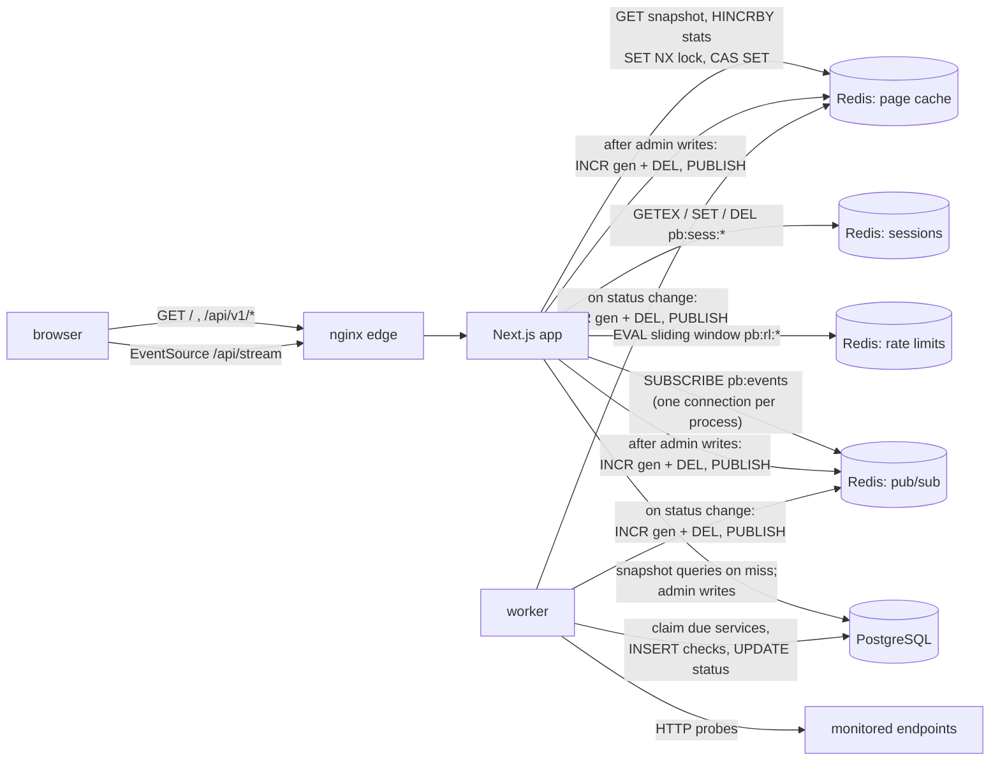

# pulse-board

A service status page with its own monitoring: a worker probes HTTP endpoints
on a schedule, derives each service's status from the recent checks, stores
everything in PostgreSQL and pushes status changes through Redis to every open
browser over Server-Sent Events. Admins sign in to open incidents, post
updates and override a service's status; the public page and a rate-limited
JSON API read through a stale-while-revalidate cache in Redis.

Next.js 16 (App Router) · PostgreSQL 18 · Redis 8 · TypeScript on Node 24 · nginx in front.

```bash
make up      # http://localhost:17380, admin at /admin (credentials in .env.example)
make test    # unit + integration, in Docker
make e2e     # Playwright against the running stack
```

## What is proven, and how

| claim | evidence |
|---|---|
| A status change reaches an open page without reload | e2e: the demo target is switched to 503; the open page shows `degraded` after the first failed probe, `down` after the third, and `operational` after recovery, with a JS marker proving the page never reloaded |
| An incident created in the admin panel appears live, and resolves live | e2e: two browser contexts, admin creates an incident with an affected service and resolves it; the public page follows both without reload |
| The cache never serves a snapshot older than the last event | integration: a load that read Postgres before an invalidation is not stored and is retried, so even callers already waiting on it get the new value (`tests/integration/cache.test.ts`) |
| Stale-while-revalidate refreshes once, not once per request | integration: 5 concurrent stale reads, 1 background load (Redis `SET NX` lock); 10 concurrent misses, 1 load (in-process single flight) |
| The rate limiter admits exactly the limit under concurrency | integration: 50 concurrent requests against a limit of 10 → exactly 10 admitted; refused requests are not counted; the window slides |
| The limit can't be dodged by sending `X-Forwarded-For` | e2e: two requests with different spoofed `X-Forwarded-For` through nginx land in one bucket (nginx overwrites the header with the socket address), see [Design decisions](#design-decisions) |
| Two workers never probe the same service at once | integration: 3 concurrent `claimDue` calls over 40 due services return 40 distinct ids (`FOR UPDATE SKIP LOCKED`) |
| Migrations go down and up cleanly | integration: down to an empty schema (no tables, no enum types), up, idempotent second up, one step down and up again; two concurrent migrators serialise on an advisory lock |
| The main queries use the indexes below | integration: `EXPLAIN` of the page, open-incident and due-service queries names the intended index |
| Status rules | unit: 30 tests over `deriveStatus`, `overallStatus`, incident transitions, uptime rounding, password hashing, rate-limit headers |

Test counts are from `make test` and `make e2e` on the commit in this repo:
**55 unit + integration tests** (`make test`, 7 files: 30 unit, 25 integration)
and **4 Playwright tests** (`make e2e`), all passing on commit `d962185`;
output in [`results/make-test.txt`](results/make-test.txt) and
[`results/make-e2e.txt`](results/make-e2e.txt).

## Numbers

All from real runs on the hardware below; raw output in [`results/`](results/),
tables regenerated from it with `node bench/summary.ts`
([`results/SUMMARY.md`](results/SUMMARY.md)).

**Public page**, `GET /` through nginx, rendered by Next.js from the snapshot.
autocannon, 50 connections, 30 s after a 5 s warm-up, 3 interleaved repetitions
of each mode. p50/p95/p99 are computed from every response time (autocannon's
own table has no p95). Hit rate = Redis lookups served from Redis (fresh or
stale) / all lookups during the measured 30 s.

| mode | runs | req/s | p50 ms | p95 ms | p99 ms | cache hit rate | Postgres tx/s | non-2xx |
|---|---|---|---|---|---|---|---|---|
| nocache | 3 | 69–80 | 574.3–671.8 | 974.7–1110.8 | 1261.1–1332.0 | n/a (cache off) | 217–247 | 0 |
| cache | 3 | 347–468 | 101.5–126.9 | 143.9–262.4 | 261.8–487.3 | 100.00% | 5 | 0 |
| cache-invalidate-1s | 3 | 360–457 | 98.2–108.7 | 157.5–320.0 | 204.6–692.4 | 86.73%–89.91% | 8 | 0 |

Same repetition, cache on vs off: throughput ×5.0–5.8, p95 ÷3.8–6.8. The
snapshot queries alone, 30 sequential loads with no other load from the bench:
p50 34.7–40.5 ms, p95 42.9–107.6 ms. Measured on commit `f4c6039`.

- Without the cache every page view runs the snapshot queries (30 days of
  per-minute checks for 6 services, 259,200 seeded rows), 3 Postgres
  transactions per view (217–247 transactions/s at 69–80 views/s); with it
  Postgres sees 5 transactions/s whatever the traffic,
  mostly the worker's polling and one cache refresh per 5 s.
- With the cache on, the Next.js render (one Node process) is the bottleneck,
  not Redis.
- `cache-invalidate-1s` invalidates the snapshot every second during the run,
  far more often than real incidents and status changes do; the hit rate drops
  to 86.73–89.91% and Postgres load stays at 8 transactions/s. Its latency is
  not worse than the plain cached runs: the difference between the two cached
  modes is inside the run-to-run noise of the shared VM.

**SSE fan-out.** Budget: an event published to Redis must reach a connected
client with **p95 < 500 ms**, and every client must get every event. Method
([`bench/sse.ts`](bench/sse.ts)): open N streams through nginx, wait until all
are connected, publish 20 events 500 ms apart straight to the Redis channel,
stamped with the sender's clock; the same process receives them, so
receive − send has no clock skew. The ladder goes up until the first client
count that misses the budget. Repeated 3 times.

| run | largest client count within budget | first count over budget: p95 |
|---|---|---|
| r1 | 1000 (p95 233 ms) | 1500: 599 ms |
| r2 | 1000 (p95 192 ms) | 1500: 677 ms |
| r3 | 500 (p95 189 ms) | 1000: 503 ms |

So on this machine one app process keeps **500–1000 concurrent SSE clients**
within p95 < 500 ms with every event delivered; at 1500 clients p95 was
599–677 ms. Delivery stayed at 100% in every round, including the ones over
the latency budget. Full per-round table (p50/p95/p99/max):
[`results/SUMMARY.md`](results/SUMMARY.md); raw: `results/sse-r*.txt`,
`results/sse-r*.json`. Measured on commit `52345a1`.

Where the limit is, is not settled. `docker stats` sampled every ~3 s
(`results/sse-r*-docker-stats.txt`) shows the app's peak at 97.67% of one
core in r1 but under 10% in r2 and r3, so the misses in r2/r3 are not
explained by the app's event loop alone; CPU contention in the shared VM (the
load generator runs in it too) is the likely remainder. An earlier series
with the same ladder on a quieter VM went further, but its delivery times were
taken from the wall clock, which lima steps during time sync, so it was
discarded and re-run with `performance.now()`; it is not reported here.

**Hardware.** MacBook Pro, Apple M4 Max (16 cores, 48 GiB). Everything,
including the load generators, runs in one colima VM with 4 vCPU and 5.77 GiB
(6197440512 bytes), Docker 29.5.2. The VM and the laptop were shared with
other projects' workloads during the session; at the moment of each recorded
run `docker ps` counted 8 running containers, all of them this project's
(the count is at the top of every `results/*.txt`). Limits: app 1 GiB (one
Node.js process), Postgres and Redis unlimited with default settings, nginx one
worker. Expect higher and tighter numbers on dedicated hardware.

## Architecture



Who reads and writes what:

| | PostgreSQL | Redis |
|---|---|---|
| **worker** | claims due rows of `services` (`UPDATE … WHERE id IN (… FOR UPDATE SKIP LOCKED)`), inserts into `checks`, reads the last 3 checks, updates `services.status`; prunes old `checks` hourly | on a status change: invalidates `pb:snapshot:v1`, publishes to `pb:events` |
| **public page / `GET /api/v1/status`** | only on a cache miss or background refresh: services + 24 h and 30-day uptime from `checks`, open and recently resolved `incidents` with `incident_updates` and `incident_services` | reads `pb:snapshot:v1`; the API also runs the sliding window in `pb:rl:api:<ip>` |
| **`/api/stream` (SSE)** | — | one `SUBSCRIBE pb:events` per app process, fanned out in memory to every stream |
| **admin panel** | reads Postgres directly (never the cache); writes `incidents`, `incident_updates`, `incident_services`, `services.status_override`; login reads `admins` | sessions in `pb:sess:<id>`; login attempts limited in `pb:rl:login:*`; after each write invalidates the snapshot and publishes |
| **`/api/v1/subscriptions`** | inserts / deletes `subscriptions` | `pb:rl:subscribe:<ip>` |

Every write follows the same order: commit to Postgres → invalidate the cache
→ publish. A browser that refetches on the event therefore can't get the old
snapshot back ([`lib/ops.ts`](lib/ops.ts)).

### Status rules

A check passes when the endpoint answers the expected status within the timeout.
From the newest three checks: three failures → `down`; the last one failed →
`degraded` (a blip, not confirmed); the last one passed but slower than the
service's threshold → `degraded`; otherwise `operational`. One passing check
recovers. A manual override from the admin panel wins over the checks until it
is cleared. The page banner is the worst service status, raised by open
incidents (`major` → at least degraded, `critical` → outage). A resolved
incident can only be reopened as `investigating`. All of it is pure code in
[`lib/status.ts`](lib/status.ts).

### Schema

[`migrations/`](migrations/), plain SQL with an `up` and a `down` per version,
applied by [`lib/migrate.ts`](lib/migrate.ts) (each version in a transaction,
one migrator at a time under `pg_advisory_lock`, `node scripts/migrate.ts down 1`
to step back).

| table | what | indexes and the query each one serves |
|---|---|---|
| `services` | endpoint, interval, timeout, expected status, latency threshold; derived `status`, manual `status_override`, `next_check_at` | `services_next_check_idx (next_check_at)`: the worker's "what is due" |
| `checks` | one row per probe: `ok`, HTTP status, latency, error | `checks_service_time_idx (service_id, checked_at DESC) INCLUDE (ok)`: per-service 24 h and 30-day uptime as index-only scans; `checks_checked_at_brin` (BRIN): retention deletes of the oldest rows |
| `incidents` | title, status, impact, `resolved_at` (a `CHECK` keeps it set exactly when status is `resolved`) | partial `incidents_open_idx (created_at DESC) WHERE resolved_at IS NULL`: open incidents; partial `incidents_resolved_idx (resolved_at DESC) WHERE resolved_at IS NOT NULL`: last 7 days |
| `incident_services` | which services an incident affects | PK `(incident_id, service_id)`; `(service_id)` for the reverse lookup and FK cascades |
| `incident_updates` | timeline of status + message + author | `(incident_id, created_at DESC)` |
| `subscriptions` | e-mail, optional service, unsubscribe token | unique `(lower(email), coalesce(service_id, 0))`: one subscription per address and service, all-services counted as a value |
| `admins` | username, scrypt hash | unique `username` |

Enums: `service_status`, `incident_status`, `incident_impact`.

### Redis, three roles (and a fourth)

1. **Page cache** ([`lib/cache.ts`](lib/cache.ts)): the whole page snapshot as
   one JSON value with a `freshUntil` stamp and a TTL of fresh + stale
   (5 s + 60 s). Fresh → served. Stale → served, and one background refresh
   across all app instances (`SET NX PX` lock). Missing → loaded inline, with
   concurrent misses in one process sharing a single load. Invalidation by
   event: `INCR` a generation counter and `DEL` the value; a load stores its
   result only if the generation is unchanged (a Lua compare-and-set), so a
   load that raced an event cannot put the old snapshot back.
2. **Admin sessions** ([`lib/session.ts`](lib/session.ts)): the cookie holds
   a 256-bit random id (`HttpOnly`, `SameSite=Lax`, `Secure` behind TLS); the
   session lives in Redis with an 8 h sliding TTL refreshed by `GETEX`. Logout
   deletes it, so it is revoked server-side at once.
3. **Pub/sub → SSE** ([`lib/events.ts`](lib/events.ts),
   [`app/api/stream/route.ts`](app/api/stream/route.ts)): one subscriber
   connection per app process, fanned out in memory to every open stream. A
   stream more than 256 chunks behind is closed instead of buffering without
   bound; `EventSource` reconnects and the page re-renders from the server to
   cover what it missed.
4. **Rate limiting** ([`lib/ratelimit.ts`](lib/ratelimit.ts)): a sliding
   window log in a sorted set per client, one Lua script, Redis `TIME` as the
   clock. Public API: 60 requests/min per address; admin login: 10 attempts per
   15 min per address and username.

## Design decisions

- **Snapshot cache, not query cache.** The public page is the same for every
  visitor, so the unit of caching is the whole page model. One key means one
  invalidation and one refresh, and the hit rate is easy to reason about.
- **Push the change, refetch the rest.** A service status event carries the new
  status and the page applies it in place; an incident event only says
  "something changed" and the page calls `router.refresh()`, which re-renders
  the server component from the (just invalidated) cache. Small events, one
  source of truth.
- **Invalidate on events, expire as a backstop.** Status changes and incidents
  invalidate immediately; uptime percentages move with every check and are
  allowed to be up to ~5 s old (fresh window) rather than invalidating on every
  probe.
- **Generation counter instead of plain `DEL`.** Plain delete-on-write has a
  classic race: a reader that queried Postgres just before the write stores the
  old value just after the delete. The generation check closes it.
- **SSE, not WebSockets.** Updates only flow server → browser; SSE is plain
  HTTP, goes through nginx with `proxy_buffering off`, and `EventSource`
  reconnects on its own.
- **One Redis subscriber per process.** N browsers cost one Redis connection,
  not N. Horizontal scaling is more app processes, each with its own
  subscriber.
- **Worker as a separate process with `SKIP LOCKED`.** Probing must not depend
  on page traffic, and several workers can share the table without a
  coordinator. Claiming and rescheduling is one `UPDATE … RETURNING`.
- **Status derived in pure code from the last 3 checks.** One failed probe
  shows as degraded, three as down: flapping endpoints don't page everybody,
  real outages show within three intervals. Easy to unit-test.
- **Server-side sessions in Redis over JWTs.** Logout and revocation are real,
  the cookie carries nothing but a random id.
- **nginx in front.** Next.js keeps a client-supplied `X-Forwarded-For` as is
  (`??=` in its server), so without a proxy the per-IP limit could be dodged by
  sending the header. nginx overwrites it with the socket address. It also
  needs per-route SSE settings anyway.
- **Sliding-window log, not fixed window or token bucket.** Exact, no burst at
  window edges, and simple to show correct in a test. The cost is one sorted
  set member per admitted request; at 60/min that's nothing. A sliding-window
  counter would be the choice for limits in the thousands.
- **Integration tests on compose, not Testcontainers.** The tests run in a
  container on the compose network against their own throwaway Postgres and
  Redis (`tmpfs`, `profiles: [test]`). No host port mapping needed, which also
  sidesteps the broken colima port forwarding described below, and CI runs the
  exact same command.
- **TypeScript without a build step for the worker and scripts.** Node 24
  strips types natively (`erasableSyntaxOnly` in `tsconfig.json` enforces the
  subset), so the worker shares `lib/` with the Next.js app as-is.
- **scrypt from `node:crypto`** for passwords: no native dependency, parameters
  stored with the hash so they can be raised later.

## Running it

Needs Docker with Compose v2. Ports (all overridable in `.env`): page and API
`17380` (nginx), Postgres `17381`, Redis `17382`, demo target `17383`.
Compose project name: `pulseboard`.

```bash
make up                                   # or: docker compose up -d --build --wait
open http://localhost:17380               # sign in at /admin with ADMIN_* from .env.example
curl -XPOST localhost:17383/svc/search/fail   # watch "Search" go degraded, then down
curl -XPOST localhost:17383/svc/search/ok
make down                                 # removes this project's containers and volumes only
```

The seeded services point at a small demo target
([`scripts/demo-target.ts`](scripts/demo-target.ts)) whose endpoints answer
200, 503 or slowly on command, so the demo and the e2e tests don't depend on
the internet. `.env.example` holds dev-only values; the admin password there
was generated for this repo and protects nothing.

**If `docker pull` fails with `error getting credentials … docker-credential-desktop`**
(a `"credsStore": "desktop"` left in `~/.docker/config.json` without Docker
Desktop installed), don't edit the global file; use a private config dir for
this shell:

```bash
mkdir -p ~/.config/docker-nocreds
echo "{\"cliPluginsExtraDirs\": [\"$HOME/.docker/cli-plugins\"]}" > ~/.config/docker-nocreds/config.json
export DOCKER_CONFIG=~/.config/docker-nocreds
export DOCKER_HOST=unix://$HOME/.colima/default/docker.sock   # the colima context lives in the old config dir
```

`cliPluginsExtraDirs` keeps `docker compose` working (plugins are found via the
config dir), `DOCKER_HOST` replaces the context.

**If `localhost:17380` refuses connections on colima** while `docker ps` shows
the port published: the lima SSH port forwarder can fail (`-O forward … exit
status 255` in `~/.colima/_lima/colima/ha.stderr.log`). A private tunnel works
without restarting the VM:

```bash
port=$(lsof -nP -a -c limactl -iTCP -sTCP:LISTEN | awk 'NR==2{split($9,a,":");print a[2]}')
ssh -F /dev/null -i ~/.colima/_lima/_config/user -o StrictHostKeyChecking=no -o UserKnownHostsFile=/dev/null \
    -p "$port" -f -N -L 17380:127.0.0.1:17380 -L 17383:127.0.0.1:17383 "$USER@127.0.0.1"
```

`make test`, `make e2e` and the benchmarks run inside the compose network and
don't need either port.

## Reproducing the measurements

```bash
make bench-page   # ~6 min: 3 × (no cache, cache, cache + invalidation every 1 s), 30 s each
make bench-sse    # ~10 min: 3 × the client ladder
node bench/summary.ts > results/SUMMARY.md
```

[`bench/run.sh`](bench/run.sh) restarts the app with `CACHE_DISABLED=1` or `0`
between runs, records the machine and the number of running containers at the
top of every `results/*.txt`, and runs the load generators
([`bench/page.ts`](bench/page.ts), [`bench/sse.ts`](bench/sse.ts)) in a
container on the compose network, so the load generator shares the VM's
4 vCPU with the system under test.

## Limitations

- **No e-mail.** Subscriptions are stored (with an unsubscribe token and a
  `DELETE` endpoint) but nothing sends notifications or confirmation mails; the
  API answers the same for new and existing addresses so it can't be used to
  enumerate subscribers.
- **One app process in the measurements.** SSE fan-out and page rendering are
  bounded by one Node event loop; more app replicas behind nginx is the next
  step and needs no code change (each has its own subscriber).
- **Events are fire-and-forget.** Redis pub/sub does not store messages; a
  browser that is disconnected misses them and resyncs by re-rendering on
  reconnect. A gap between the first render and the first SSE connection is
  not covered (an event in that window is seen at the next one).
- **Checks are one table.** Retention deletes rows older than 90 days in
  batches; at many services × short intervals, time partitioning (dropping
  partitions instead of deleting) and an hourly rollup for the 30-day bars
  would be the next steps.
- **Probes come from one place.** A single worker location can't tell "the
  service is down" from "the path between us is down"; multi-region probes with
  a quorum are out of scope.
- **The admin model is flat.** One role, no audit log beyond the author of each
  incident update.
- The numbers come from a laptop VM shared with other workloads; see the
  hardware note. Expect better and tighter numbers on dedicated hardware.

## Layout

```
app/              Next.js: public page (server + client component), admin, API routes, SSE
lib/              cache, rate limit, sessions, events, snapshot queries, writes, status rules, migrator
worker/           probe scheduler and HTTP probe
scripts/          migrate, seed, demo target
migrations/       SQL, up and down
tests/unit/       pure logic
tests/integration Postgres + Redis (compose profile "test")
e2e/              Playwright
bench/            load generators, runner, summary
deploy/           nginx
results/          raw benchmark output
```

## Third-party software

| | license | used for |
|---|---|---|
| [Next.js](https://github.com/vercel/next.js) 16.4.3, [React](https://github.com/facebook/react) 19.3.1 | MIT | app |
| [node-postgres (`pg`)](https://github.com/brianc/node-postgres) 8.23.1 | MIT | Postgres client |
| [ioredis](https://github.com/redis/ioredis) 6.0.0 | MIT | Redis client |
| [Vitest](https://github.com/vitest-dev/vitest) 5.0.5 | MIT | unit and integration tests |
| [Playwright](https://github.com/microsoft/playwright) 1.64.1 | Apache-2.0 | e2e tests |
| [autocannon](https://github.com/mcollina/autocannon) 8.0.0 | MIT | page load test |
| [TypeScript](https://github.com/microsoft/TypeScript) 6.0.3 | Apache-2.0 | type checking |
| PostgreSQL 18 (image `postgres:18-alpine`) | PostgreSQL License | database |
| Redis 8 (image `redis:8-alpine`) | RSALv2 / SSPLv1 / AGPLv3 | cache, sessions, pub/sub, rate limits |
| nginx 1.29 (image `nginx:1.29-alpine`) | BSD-2-Clause | edge proxy |
| Node.js 24 (image `node:24-alpine`) | MIT | runtime |

## License

MIT, see [LICENSE](LICENSE).
